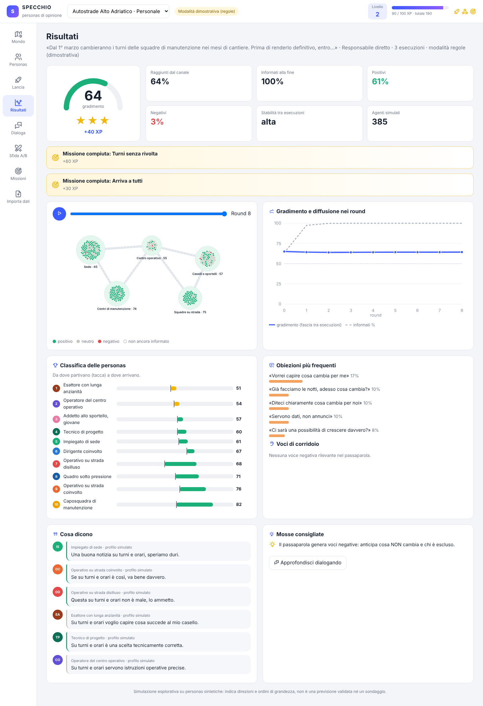

# SPECCHIO · simulatore di personas di opinione

Un laboratorio, con grafica da gioco, per provare **prima di diffonderli** annunci, comunicati e proposte su una popolazione di **personas di opinione**: profili tipo costruiti da dati aggregati di indagini (LimeSurvey, CATI, CAWI).

Con SPECCHIO puoi:

- **Costruire il mondo**: un'azienda divisa in reparti oppure una città divisa in quartieri, con la composizione di personas che preferisci.
- **Lanciare un annuncio** scegliendo il canale (e-mail, responsabile diretto, incontro, social, giornale, gruppi di quartiere…) e i destinatari.
- **Guardare la reazione round per round**: chi viene raggiunto, come cambia il gradimento, dove nascono obiezioni e voci di corridoio.
- **Dialogare con le personas**, come in un'intervista.
- **Sfidare due versioni** dello stesso messaggio (A/B) a parità di condizioni.
- **Completare missioni**, guadagnare XP e badge.
- **Importare i dati reali** di un'indagine: una persona per ogni gruppo con almeno 10 risposte, usando solo le medie.

> Le simulazioni sono **esplorative**: indicano direzioni e ordini di grandezza, non sono previsioni validate né sondaggi. Ogni risultato va confermato con un ascolto reale.



---

## Avvio rapido

Serve Python 3.11 o successivo.

```bash
git clone https://github.com/techmanagementdev/SPECCHIO-2027-Mirofish-.git
cd SPECCHIO-2027-Mirofish-
./avvia.sh
```

Poi apri **http://localhost:8000**.

Senza configurare nulla il sistema funziona in **modalità dimostrativa**: le reazioni sono calcolate con regole trasparenti (vedi [docs/METODO.md](docs/METODO.md)).

### Con un modello linguistico (consigliato)

Copia `.env.example` in `.env` e inserisci una chiave:

```bash
cp .env.example .env
# ANTHROPIC_API_KEY=...   oppure   OPENAI_API_KEY=... (anche API compatibili OpenAI)
./avvia.sh
```

Con il modello attivo ogni persona legge davvero il messaggio, ne dà un giudizio, formula la propria obiezione e risponde nel dialogo con la sua voce. La diffusione nel passaparola resta calcolata dal motore, così i costi restano bassi: **una chiamata per persona per esecuzione**, non una per agente.

### Con Docker

```bash
docker build -t specchio .
docker run -p 8000:8000 --env-file .env specchio
```

Il repository è pronto anche per la pubblicazione su Railway: crea un servizio dal repository, che userà il `Dockerfile`, e inserisci le chiavi tra le variabili d'ambiente.

---

## Accesso e area riservata

Se è impostata una password (variabili `ACCESS_PASSWORD` e `ADMIN_PASSWORD`, oppure dall'area riservata) il sistema chiede l'accesso:

- **area visibile** `/`: simulatore per gli utenti;
- **area riservata** `/admin`: modello linguistico e chiavi API, parametri della simulazione, mondi visibili, modifica e caricamento dei mondi, cambio password, statistiche d'uso.

La password dell'area riservata apre anche l'area visibile. Senza password impostate (uso sul proprio computer) l'accesso è libero.

Su un server i dati (impostazioni, mondi creati, chiave di firma delle sessioni) stanno nella cartella indicata da `DATA_DIR`: su Railway va montato un volume.

## Collegamento a LimeSurvey

Dall'area riservata si inseriscono indirizzo, utente e password di LimeSurvey (oppure le variabili `LIMESURVEY_URL`, `LIMESURVEY_USER`, `LIMESURVEY_PASSWORD`). Su LimeSurvey va attivata l'interfaccia RemoteControl: **Configurazione → Impostazioni globali → Interfacce → Interfaccia RPC = JSON-RPC**.

Poi, in **Importa dati → Da LimeSurvey**:

1. compare l'elenco dei sondaggi con il numero di risposte complete;
2. scegli un sondaggio: le domande sono mostrate con il loro testo;
3. indichi la domanda che definisce i gruppi (es. categoria professionale), quelle di clima o soddisfazione e quella sulla fiducia;
4. il sistema crea una persona per ogni gruppo con almeno 10 risposte, con i nomi delle risposte (es. «Operativi su strada» invece di «A1»);
5. il nuovo mondo è subito pronto per la fase di stimolo: **Lancia**, **Sfida A/B**, **Dialoga**.

Le risposte scaricate restano in memoria sul server per pochi minuti, solo per calcolare le medie: non vengono salvate.

## I mondi inclusi

| Mondo | Tipo | Contenuto |
|---|---|---|
| **Autostrade Alto Adriatico · Personale** | organizzazione | 10 personas su 6 categorie (dirigenti e quadri, impiegati, tecnici, operativi su strada, esazione, centro operativo), 5 reparti, 5 canali interni. Struttura della proposta EMI-AAA-2026-02 |
| **Autostrade Alto Adriatico · Territorio** | città/territorio | 8 personas dei comuni attraversati e limitrofi, 6 macroaree, 6 canali. Struttura della proposta EMI-AAA-2026-01 |
| **Borgo Nuovo · città di esempio** | città | 8 personas in 5 quartieri, con annunci su ZTL, parco, TARI, trasporti |

Per provare l'importazione c'è un file di esempio inventato, `docs/esempio_limesurvey.csv`, nel formato di un export LimeSurvey (separatore punto e virgola, codici delle risposte).

I valori delle personas incluse sono **illustrativi**: vanno sostituiti con i risultati reali delle indagini, tramite **Importa dati** o modificando i file in `backend/presets/`.

---

## Struttura

```
backend/
  app/
    analyzer.py   temi, verso e stile del messaggio
    world.py      mondi, popolazione di agenti, rete sociale
    engine.py     reazioni, passaparola per round, più esecuzioni, obiezioni, consigli
    llm.py        collegamento opzionale ad Anthropic o API compatibili OpenAI
    chat.py       dialogo con le personas
    importer.py   creazione di un mondo da CSV con soglia di anonimato
    main.py       API FastAPI e server dell'interfaccia
  presets/        i mondi in JSON
  tests/          test automatici (python -m pytest)
frontend/         interfaccia gamificata (HTML, CSS e JavaScript, nessuna build)
docs/             metodo, strumenti open source da integrare, schermate
scripts/          scarico facoltativo dei progetti open source di riferimento
```

## Open source

SPECCHIO è un motore autonomo e leggero. Per simulazioni sociali su larga scala si possono affiancare progetti open source come OASIS, AgentSociety, Concordia, TinyTroupe, EDSL e MiroFish: cosa scaricare, con quale licenza e come collegarli è spiegato in **[docs/OPEN_SOURCE.md](docs/OPEN_SOURCE.md)**.

## Regole d'uso

- Solo **dati aggregati**: nessuna risposta individuale, soglia minima di 10 risposte per gruppo.
- **Mai dati dei clienti nel repository**: i mondi creati dagli utenti finiscono in `data/`, esclusa da git.
- Le personas **non sono persone reali** e i risultati vanno presentati come esplorativi.
- Non usare il sistema per profilare persone identificabili o per inviare messaggi personalizzati a elettori: per gli usi politici valgono GDPR, AI Act e legge 28/2000 (vedi [docs/METODO.md](docs/METODO.md)).
